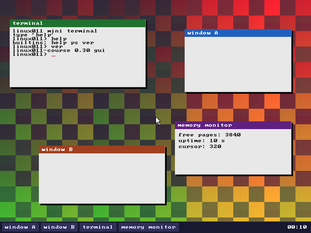

# Linux 0.11 课程（30 天重构版）

> 以 [30dayMakeOS](https://github.com/yourtion/30dayMakeOS)《30 天自制操作系统》的进度规划与教学思想，
> 重构 Linux 0.11 课程：**每天一个可运行产物，每课 QEMU 自动验收，GRUB 引导，最终做出图形桌面。**



## 快速开始

```bash
# 工具链(宿主机, Ubuntu 24.04+)
sudo apt-get install -y build-essential gcc-multilib nasm mtools \
    grub-pc-bin xorriso cpio qemu-system-x86 python3

# 单课: 构建 + QEMU 无头测试(串口断言 + 截图 + 像素断言)
make -C days/day04-grub-multiboot test

# 全部 30 课测试矩阵
make test-all

# 交互运行某课(弹出 QEMU 窗口)
make -C days/day30-release run
```

## 双轨课程结构

| 轨道 | 位置 | 说明 |
|---|---|---|
| **动手轨（主线）** | `days/day01 … day30` | 30 天从 MBR 到图形桌面，每课完整可构建快照 |
| **精读轨（保留）** | `source/` + `docs/` | karottc/linux-0.11 原始源码（赵炯注释）+ 既有模块文档 |
| **分课讲义** | `docs/days/dayNN.md` | 每课知识点/代码走读/验收说明/0.11 对照/实验建议 |
| **课程设计** | `docs/course-plan.md` | 30 天大纲与重构方案 |
| **实验环境** | `env/` | Xfce + noVNC 可复现容器（浏览器即得桌面 + QEMU 图形） |

## 30 天日程

| 周 | 天 | 内容 |
|---|---|---|
| 一 引导与硬件 | 01-07 | MBR → INT13H 读盘 → 保护模式 → **GRUB multiboot** → C 控制台 → 分页+IDT → PIT 时钟 |
| 二 内核核心 | 08-14 | 键盘 tty → printk/vsprintf → 物理页管理 → 调度器 → fork/exit/wait → int 0x80 ring3 → 内核 shell |
| 三 文件与用户态 | 15-20 | ramfs → cat/write → exec → initrd(ATA) → 用户态 init(fork/execve/waitpid) → 里程碑自检 |
| 四 图形桌面 | 21-30 | VBE 帧缓冲 → 点阵字体 → 绘图 API → PS/2 鼠标 → 图层 → 窗口拖动 → 任务栏时钟 → 图形终端 → 应用窗口 → 发布版 |

最终成果（day30）：GRUB 引导 → VBE 640×480×32 桌面 → 多窗口 + 鼠标拖动 + 任务栏时钟 + 图形终端 + 内存监视应用。

## 每课的自动验收

每课 `make test` 做三件事（`tools/qemu-test.sh`）：

1. **串口顺序断言** `test/expect.txt` —— 内核把状态打印到 COM1，测试器逐条匹配；
2. **QMP 截图** `build/test/screen.png` —— 图形课留档，人眼可复核；
3. **像素断言** `Makefile` 的 `PIXEL` 变量 —— 对截屏指定坐标断言颜色（窗口/光标/任务栏落位）；
   键盘/鼠标交互课通过 QMP `send-key` / `input-send-event` 注入输入。

测试退出：内核写 0xF4 端口经 `isa-debug-exit` 干净退出，或测试器超时经 QMP 收割。

## 与 Linux 0.11 的关系

动手轨的代码是**教学重写**（现代 gcc -m32 + GRUB + QEMU），按 0.11 的模块思想逐步生长；
每课讲义的"对照阅读"指向 `source/` 中对应的原始文件（`bootsect.s`、`head.s`、`sched.c`、`fork.c`、
`system_call.s`、`memory.c`、`console.c`、`hd.c` 等）。原源码精读轨与 `source.sha256` 校验原样保留。

## 可复现性

- 每课目录为**完整快照**，互相独立可构建（30dayMakeOS 式）；
- `30day-course` 分支上**每课一个 commit**，`git checkout` 任意提交即回到当日状态；
- 工具链固定：`env/Dockerfile` 提供 Xfce + noVNC 容器，浏览器打开 `http://localhost:8080` 即得实验桌面。

## 关于 "Xfce 桌面"

Linux 0.11 时代的内核无法运行现代 Xfce（无 framebuffer/网络/现代 ABI）。本项目从两层满足"桌面"需求：

1. **day21–30 自研图形桌面**：多窗口、鼠标拖动、任务栏时钟、图形终端、应用（30dayMakeOS 式收官）；
2. **`env/` Xfce 实验容器**：完整 Xfce 桌面 + QEMU 图形窗口，浏览器即用，用于"人肉"操作课程系统。

## 目录速览

```
days/dayNN-*     30 课快照(每课 Makefile/test/源码)
mk/              共享构建规则(kernel.mk/test.mk/linker.ld) + freestanding 头
tools/           qemu-test.sh、QMP 客户端、像素断言、mkinitrd
docs/            course-plan.md + days/ 分课讲义 + 原有精读文档
source/          Linux 0.11 原始源码(只读精读轨)
env/             Xfce + noVNC 实验容器
```
